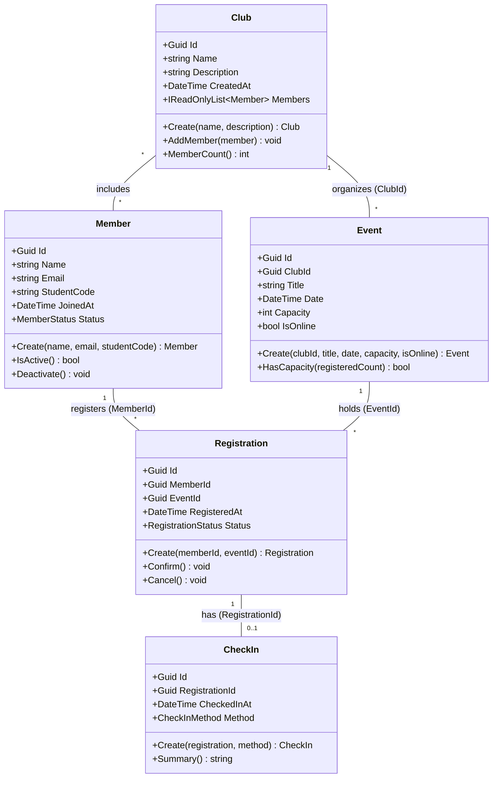

# Sơ đồ lớp sơ bộ – EduHub

Vẽ bằng Mermaid (hiển thị trực tiếp trên GitHub) hoặc xuất ảnh từ draw.io rồi đặt cạnh file này.
Ghi rõ thuộc tính chính, khoá ngoại (FK) và bội số quan hệ (1, *, 0..1).

